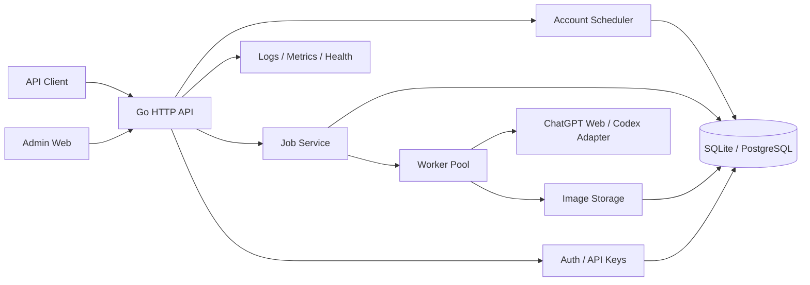

# chatgpt2api 的 Go 复刻方案

分析基线：当前仓库 `chatgpt2api` 1.8.0（`dc105e5`），后端为 FastAPI，前端为 Next.js。
本文针对“用 Go 复刻图片生成与账号管理”整理功能边界、Go 架构和优先补齐项。

## 结论

当前项目不是单纯的“生图接口 + 账号列表”，而是一个带多账号调度、异步图片任务、
图片资产管理、代理、备份和运维后台的 ChatGPT Web 能力网关。

如果只准备先做两个功能，建议先完成以下闭环，而不是只做两个页面：

1. OpenAI 兼容的图片生成、图片编辑和模型列表接口。
2. 可恢复的异步图片任务状态机，支持进度、超时、继续等待和取消。
3. 账号池的导入、刷新、登录恢复、额度、并发控制和代理绑定。
4. 图片落盘、缩略图、浏览、标签、下载和保留期清理。
5. 管理员登录、API 访问令牌、设置、日志和健康检查。
6. 数据迁移、备份和恢复。

文本对话、Responses、Anthropic、Web Search、PPT/PSD 等能力属于当前仓库的扩展功能，
可以放到图片主链路稳定之后。

## 当前项目功能盘点

### 对外 API

| 能力 | 当前实现 |
| --- | --- |
| 模型列表 | `GET /v1/models` |
| 文生图 | `POST /v1/images/generations` |
| 图片编辑 | `POST /v1/images/edits`，支持 multipart、JSON、URL、base64 和多参考图 |
| Chat 兼容 | `POST /v1/chat/completions`，支持文本和图片场景 |
| Responses 兼容 | `POST /v1/responses`，支持文本、图片生成工具和 Web Search |
| Anthropic 兼容 | `POST /v1/messages` |
| 搜索 | `POST /v1/search` |
| 可编辑文件 | PPT、PSD 生成及 `GET /v1/editable-file-tasks`、`GET /files/{path}` |
| 图片任务 | `/api/image-tasks` 查询、创建、继续轮询 |
| 管理接口 | 账号、密钥、设置、图片、日志、代理、备份、CPA、Sub2API 等 |

### 图片链路

- 官网 `picture_v2` 链路：准备会话、Sentinel/PoW、上传参考图、SSE、轮询、解析文件、下载。
- Codex 链路：使用 `codex-gpt-image-2`，只路由到支持 Codex 的账号。
- 多图生成：`n` 限制 1 到 4，后端可并行，每张图使用独立账号。
- 任务状态：`queued`、`running`、`success`、`error`；错误超时后可继续轮询。
- 重试：Token 失效、TLS/连接错误、模型返回文本、轮询超时分别处理。
- 输出：默认保存本地图片，支持 WebDAV 和本地双写。
- 尺寸和画质：官网链路目前主要把 `size`、`quality` 作为提示词后缀，目标尺寸不能严格保证；
  Codex 链路会把尺寸作为图片生成工具参数。这正是当前功能清单仍把“图片尺寸参数”标为待实现的原因。

### 账号池

- 账号字段：Access Token、Refresh Token、ID Token、类型、来源、状态、额度、恢复时间、邮箱、
  代理、成功/失败次数、限流信息、最近刷新错误等。
- 导入：Access Token、Session JSON、Codex 认证 JSON、账号 JSON、OAuth PKCE 登录、
  远程 CPA 文件、Sub2API 服务器。
- 刷新：异步进度、额度同步、Token 自动刷新、Refresh Token keepalive、密码重新登录。
- 状态：正常、限流、异常、禁用；异常和限流账号可按配置自动移除。
- 调度：按套餐类型和来源筛选账号，使用轮询、每账号并发上限和在途槽位。
- 导出：单账号或批量 JSON/ZIP，主要内容是完整 Token 三件套。

### 管理端

当前 Next.js 页面包括：

- `/image`：生图工作台、参考图、多图、历史记录、继续等待。
- `/accounts`：账号统计、搜索筛选、分页、批量刷新、导入、导出、编辑和删除。
- `/image-manager`：图片列表、日期筛选、标签、下载、压缩和磁盘清理。
- `/logs`：调用日志和账号日志查询、删除。
- `/debug`：文本、搜索、Skills、PSD、PPT 等调试面板。
- `/settings`：基础配置、代理、备份、API 访问令牌、接口接入、第三方画布、CPA、Sub2API。

如果按 CPAMC 的控制台结构收敛，建议页面调整为：

- 仪表盘：号池状态、可用账号、运行中任务、成功率和存储占用。
- 接入与认证：监听地址、端口、数据目录、代理和客户端 API Key 列表；TLS 由反向代理负责。
- 认证文件：账号池和凭据来源列表，对应“上游账号”。
- OAuth 登录：上游 ChatGPT 账号的 OAuth 导入流程。
- 配额管理：账号额度、恢复时间和限流状态。
- 日志查看：调用日志、账号刷新日志和任务日志。
- 配置面板：代理、图片存储、备份、任务超时和清理策略。

不再提供用户、角色、团队和租户菜单。客户端的多个 API Key 统一在“接入与认证”页面维护。

### 现有的运维能力

- JSON、SQLite、PostgreSQL/MySQL、Git 四类账号存储后端。
- 图片保留期清理、缩略图、存储空间统计、压缩和按目标空间清理。
- Cloudflare R2 定时备份、轮换、加密和下载。
- 账号池健康首页和 `/health?format=json`。
- Docker、WARP、Privoxy、FlareSolverr 部署。

## 需要补齐的功能

下面的“必须”是图片生成和账号管理真正能上线所必需的能力；“增强”是当前仓库没有、
但在 Go 版本里值得优先补上的能力。

### P0：复刻时必须补齐

#### 1. 认证与访问密钥（CPA 风格单操作员模式）

- 默认只有一个操作员，不建立用户表、角色体系、团队空间或租户隔离。
- 管理接口使用单一 `remote-management.secret-key` 认证，参考 CPA 的无 Session 模式。
- `secret-key` 保存 bcrypt 哈希；填写明文时，启动时哈希后只保存在内存。
- 所有 `/api/*` 管理请求都必须携带管理密钥；密钥为空时管理路由统一返回 404。
- 管理台始终启用；远程暴露由监听地址、防火墙和反向代理控制。
- API 客户端使用 `api-keys` 列表中的 Bearer Key，和管理密钥完全分离。
- API Key 不是用户。允许配置多条 Key 给不同客户端使用和独立吊销，但全部属于同一个操作员。
- API Key 列表支持新增、改名、复制、编辑、启用/禁用、轮换和最近使用时间。
- `/healthz` 只返回进程存活信息；详细号池状态、额度和任务统计需要管理密钥。
- 可选 TOTP；需要时记录管理请求和 Key 操作审计日志。

当前实现有管理员主密钥和普通用户子密钥，属于“多密钥 + 两个角色”，但没有用户数据隔离、
配额和权限范围。对于单人部署，这套结构应改造成“单操作员 + 客户端 API Key 列表”。

这里的“认证”只指本站管理端和 API 调用者。账号池里的 OAuth、邮箱密码登录是上游 ChatGPT
账号的凭据获取流程，和应用用户体系分开。

建议的管理端访问流程：

1. 服务启动时读取 `remote-management.secret-key`；空值则关闭全部管理路由并返回 404。
2. 浏览器打开控制台后输入管理密钥，前端只在内存或 `sessionStorage` 中保留，不写入 localStorage。
3. 每次管理请求通过 `Authorization: Bearer <management-key>` 或专用请求头校验。
4. 管理密钥轮换后旧密钥立即失效，不需要清理 Session 表。
5. `GET/POST/PATCH/DELETE /api/access/keys` 管理客户端 API Key。
6. 兼容迁移旧的 `auth-key` 和 `auth_keys.json`，统一转换成 `api-keys`，并在页面提示轮换。

单操作员模式不需要 `users`、`roles`、`permissions`、`tenants` 表。后续如果确实需要多人使用，
再在认证层增加 `actor_id` 和权限中间件，图片、任务、账号表先保留可扩展字段即可。

配置落点：

- `access_settings` 放入本地 `config.json` 或 `config.yaml`，包括监听地址、端口、代理地址
  和管理密钥哈希。TLS 由反向代理负责。
- 管理密钥只保存 bcrypt 哈希，不保存明文；环境变量可以覆盖配置文件值。
- `api-keys` 也放在配置文件中，保持 CPA 的单文件配置体验；页面编辑后原子写回。
- API Key 可以保存明文或哈希。明文仅在配置文件中，启动后只在内存中保存哈希，文件权限必须为 0600。
- 不创建 `admin_sessions` 表，也不把会话写入配置文件；每次管理请求校验管理密钥。
- 使用统计和 `last_used_at` 属于运行时数据，放内存或 SQLite，不要每次请求写配置文件。

示例（YAML 字段使用连字符；`config.json` 字段使用下划线）：

```json
{
  "host": "127.0.0.1",
  "port": 3000,
  "remote_management": {
    "secret_key": "$2a$10$replace-with-bcrypt-hash"
  },
  "api_keys": [
    {
      "name": "default",
      "key": "sk-replace-with-a-random-key",
      "enabled": true
    }
  ]
}
```

#### 2. 账号池调度器

- 账号分组：按套餐、来源、代理、地区、健康度分组。
- 调度策略：最少在途、加权轮询、优先级、配额感知和冷却时间。
- 每账号并发上限、全局并发上限和队列背压。
- 连续失败熔断、指数退避、恢复探测。
- Token 过期前刷新、Refresh Token keepalive、登录恢复。
- 导入前 dry-run、去重、字段校验和错误预览。
- 账号状态变化和失败原因保留历史，不只保存最后一次错误。
- 使用稳定的内部 `account_id` 作为主键，Access Token 只作为可轮换的凭据版本。
  否则 Token 刷新后主键变化，任务、日志和历史统计都会失去关联。

当前实现是基础轮询加每账号在途计数，复杂调度仍是功能清单里的待完善项。

#### 3. 异步图片任务引擎

- 数据库任务表，而不是 JSON 文件加线程。
- 状态：`queued`、`leased`、`running`、`polling`、`succeeded`、`failed`、`canceled`、`expired`。
- 幂等键、客户端任务 ID、最大尝试次数、退避时间和死信状态。
- 任务超时后保留 `conversation_id`，支持继续轮询。
- 支持取消、重试、批量重试和任务事件流。
- 服务重启后可以恢复任务，不把未完成任务直接标记为失败。
- 多实例部署时通过数据库租约或队列锁避免重复执行。

这是 Go 版相较 Python 版最值得做扎实的部分。

#### 4. 图片资产管理

- 本地文件系统默认存储，预留 S3/R2/MinIO 和 WebDAV 适配器。
- 保存原图、缩略图、尺寸、MIME、哈希、任务 ID、调用 Token ID、账号 ID、模型和提示词摘要。
- 支持按日期、模型、账号、标签和状态筛选。
- 支持单张/批量下载、ZIP 导出、标签、收藏和保留期清理。
- 记录磁盘占用和自动清理结果。
- 图片和可编辑文件默认使用需鉴权的下载接口或短期签名 URL，避免凭 URL 永久公开。

#### 5. 安全与输入校验

- 远程图片 URL 下载必须限制协议、私网地址、重定向次数和响应大小，避免 SSRF。
- 上传图片限制类型、尺寸、像素数和解码后的实际格式。
- 文件名和存储路径做双重规范化，阻止目录穿越。
- 所有 Token、Refresh Token、密码、代理密码和备份密钥加密存储。
- 日志中对 Token、Cookie、Authorization、API Key 做统一脱敏。
- 对管理端登录、API Token 和账号级操作增加速率限制。
- `/images/...` 和 `/files/...` 这类下载入口增加鉴权或签名 URL，避免资源长期公开暴露。

当前 Python 实现允许服务端直接请求任意 HTTP/HTTPS 图片地址，Go 版应补上 SSRF 防护。

#### 6. 设置、代理和运维

- 全局代理、账号级代理、代理连通性测试。
- 代理优先级和失效切换。
- 后台任务并发、图片保留期、任务超时、清理阈值等配置热更新。
- `/healthz`、`/readyz` 和 Prometheus `/metrics`。
- 结构化日志，按请求 ID 串联任务、账号和上游调用。

#### 7. 数据迁移、备份和恢复

- 首次启动导入现有的 `accounts.json`、`auth_keys.json`、`image_tasks.json` 和 `config.json`。
- 备份不仅支持上传和下载，还要支持恢复校验、版本号和恢复预检。
- 账号 Token 文件和备份包默认加密。
- 数据迁移要做 dry-run、数量校验和幂等重跑。

当前仓库已有 R2 备份，但没有完整的恢复流程。

### P1：建议新增

1. API Key 用量面板：按 Key 统计请求数、成功/失败、生成张数、耗时和最后使用时间。
2. 全局保护阈值：每日图片数、并发任务数、RPM 和单次 `n` 上限。
3. 任务中心页面：查看排队、运行、失败、超时和死信任务，支持重试和取消。
4. 账号分组和路由规则：例如“Pro 账号只跑 Codex 4K”“某组账号走指定代理”。
5. 图片 Webhook：任务完成、失败和继续等待事件支持回调。
6. 告警：号池无可用账号、失败率过高、Token 即将过期、磁盘空间不足时推送通知。
7. 账号健康评分：根据成功率、延迟、限流频率和连续失败计算，并参与调度。
8. 备份恢复：从 R2 选择备份、校验清单、恢复到空环境或指定命名空间。
9. 审计日志：记录谁导入了账号、导出了 Token、修改了设置、删除了图片。
10. 图片后处理：格式转换、压缩、EXIF 清理、可选水印和公开分享链接。

### P2：可暂缓

- 文本 Chat、Responses、Anthropic 完整兼容。
- Web Search。
- PPT/PSD 可编辑文件生成。
- 无限画布和第三方应用入口。
- 多租户、团队空间、计费和发票。
- 多节点水平扩展和 Redis 队列。
- 更复杂的图片编辑工具和画布。

这些功能会显著扩大上游协议和测试面，不建议放进第一个 Go MVP。

### PPT/PSD 可编辑文件的真实机制

当前项目里的 PPT/PSD 不是本地用库生成 Office/Photoshop 文件，而是把需求发给上游
ChatGPT Agent，让它在对话中生成文件，再由本项目下载产物：

- 模型固定为 `gpt-5-5-thinking`，思考强度为 `extended`。
- PPT 可以没有参考图；PSD 必须至少有一张 `base64_images`。
- PPT 的目标产物是 `.pptx`/`.ppt` 加一个素材 `.zip`；PSD 的目标产物是 `.psd` 加图层 `.zip`。
- 后台每 5 秒查询一次 conversation，最长等待 1200 秒。
- 任务状态只有 `queued`、`running`、`success`、`error`，没有细粒度进度。
- 成功后返回 `conversation_id`、`primary_url`、`zip_url`，文件保存在 `data/files/{ppt|psd}/{task_id}`。
- 当前实现每个任务直接创建线程，没有全局并发上限；文件目录也没有自动保留期清理。

因此这两个功能的实际依赖是：可用的 Plus/Team/Pro/Enterprise 账号、上游 Agent 的文件生成能力、
长时间轮询和较大的磁盘空间。它们不是“低配服务器上顺手就能加”的轻量功能。

## 推荐的 Go 架构



### 技术选型

- HTTP：Go 标准库 `net/http` 加轻量路由（如 `chi`），减少框架绑定。
- 数据库：默认 SQLite，使用纯 Go 驱动；生产可切换 PostgreSQL。
- 迁移：内嵌 SQL migrations，启动时检查和执行。
- 查询层：`sqlc` 或轻量 repository，不把 SQL 散落在 handler。
- 配置：环境变量加数据库设置表，运行时通过原子快照读取。
- 任务：数据库租约加固定大小 worker pool；先不引入 Redis。
- 日志：`log/slog` 结构化 JSON 日志。
- 监控：Prometheus 指标，必要时加 OpenTelemetry。
- 前端：优先复用现有 Next.js 静态产物，通过 `embed.FS` 嵌入 Go 二进制。
- 部署：单二进制、Docker、SQLite 持久卷；后期再支持 Postgres 多实例。

### 建议目录

```text
cmd/server
internal/config
internal/auth
internal/account
internal/scheduler
internal/upstream/chatgpt
internal/upstream/codex
internal/upstream/oauth
internal/image
internal/task
internal/storage
internal/admin
internal/observability
migrations
web
```

### 核心持久化

| 表 | 用途 |
| --- | --- |
| `config.json` | 访问配置、管理密钥哈希、API Key 列表、监听、TLS、可信代理 |
| `api_key_usage` | 可选；API Key 请求计数和最后使用时间，不存密钥原文 |
| `accounts` | 账号元数据、状态、额度、套餐、来源、代理 |
| `account_secrets` | 加密后的 Access/Refresh/ID Token、密码 |
| `account_events` | 刷新、登录、限流、失效、失败历史 |
| `account_groups` | 账号分组和路由标签 |
| `image_jobs` | 图片任务状态、幂等键、租约、重试、进度 |
| `images` | 图片元数据、存储位置、尺寸、标签 |
| `settings` | 可热更新配置 |
| `audit_logs` | 管理操作审计 |
| `request_logs` | API 调用和上游耗时摘要 |

## MVP 接口范围

第一版建议保留当前接口命名，便于现有前端复用：

- `GET /v1/models`
- `POST /v1/images/generations`
- `POST /v1/images/edits`
- `GET /api/image-tasks`
- `POST /api/image-tasks/generations`
- `POST /api/image-tasks/edits`
- `POST /api/image-tasks/{task_id}/resume-poll`
- `DELETE /api/image-tasks/{task_id}`
- `GET/POST/PATCH/DELETE /api/access/keys`
- `GET/PUT /api/access/settings`
- `GET/POST /api/accounts`
- `DELETE /api/accounts`
- `POST /api/accounts/refresh`
- `GET /api/accounts/refresh/progress/{id}`
- `POST /api/accounts/re-login`
- `POST /api/accounts/export`
- `GET/POST /api/settings`
- `GET /api/images`
- `POST /api/images/delete`
- `POST /api/images/download`
- `GET /api/logs`
- `GET /healthz`
- `GET /readyz`
- `GET /metrics`

后续再增加 `/v1/chat/completions`、`/v1/responses` 等文本协议。

## 分阶段实施

### 阶段 1：基础工程

- 建立 Go module、配置、SQLite、migration、日志和健康检查。
- 完成管理密钥中间件、客户端 API Key 和统一错误格式。
- 建立账号、任务、图片、设置、日志表。

### 阶段 2：账号池

- 账号导入、去重、刷新、额度同步、Token 刷新和登录恢复。
- 账号列表、筛选、批量操作、导出和代理测试。
- 可观测的刷新进度。

### 阶段 3：图片主链路

- 官网图片生成和编辑适配器。
- Codex 图片适配器。
- SSE 解析、任务状态机、轮询和继续等待。
- 多图并行、账号并发和重试策略。

### 阶段 4：管理端

- 复用现有 Next.js 页面，接入 Go API。
- 生图工作台、账号管理、图片管理、日志和设置。
- 任务中心和账号健康面板可作为新增页面。

### 阶段 5：上线加固

- 加密存储、SSRF 防护、审计日志、登录限流和全局保护阈值。
- 备份恢复、数据迁移、Prometheus 指标和告警。
- Docker 镜像和多架构构建。

## 低配服务器优化

目标：在一台低内存、低 CPU 的单机服务器上，用单个 Go 进程完成 API、管理页面和后台任务。

### 进程与部署

- 优先使用 systemd 直接运行 Go 二进制，减少 Docker、Python、Node 常驻进程。
- 前端只提供静态文件，不在服务器端运行 Next.js SSR；如果需要更轻的管理端，
  可以用 Go 模板加 HTMX，减少前端资源和构建依赖。
- 不默认启动 WARP、Privoxy、FlareSolverr、Redis。只在确认上游网络必须使用时再加一个轻量代理。
- 设置 `GOMEMLIMIT`，例如 512 MB 机器设为 `350MiB`，256 MB 机器设为 `160MiB`，
  同时根据实际压测调整 `GOGC`。

### 并发与任务

- 默认图片 worker 数为 1，最多 2；多图请求默认串行执行。
- 每个上游账号默认并发 1，`parallel-generation=false`。
- 所有队列都有容量上限，队列满时返回 429，避免无限 goroutine 和内存增长。
- 账号刷新 worker 默认 1，只刷新限流、即将过期和异常账号；全量刷新放在低频任务或手动触发。
- 图片任务进度不要每个 SSE 事件都写数据库，按固定间隔批量写一次。

### 图片内存

- 图片默认存本地磁盘，SQLite 只存元数据，不存图片二进制。
- 默认返回 `url`，只有客户端明确要求时才生成 `b64_json`。
- 图片上传和下载使用流式读写，禁止无上限 `io.ReadAll`。
- 解码缩略图前先用 `image.DecodeConfig` 检查宽高和像素数，限制最大尺寸。
- 缩略图按需生成，单并发生成，不启动全量预生成。
- 不在上传时做压缩、格式转换、EXIF 重写等 CPU 密集操作。

### 数据库与日志

- SQLite 开启 WAL、`synchronous=NORMAL` 和较小的缓存；单进程只需要一个写连接。
- 关闭或限制文本响应缓存，默认不缓存图片。
- 日志用轮转文件或 stdout，限制为 7 到 14 天，不记录完整 prompt、base64 和响应体。
- 健康检查使用缓存快照，不在每次请求时遍历所有账号或统计磁盘。
- 不引入 OpenTelemetry；先使用轻量计数器、`/healthz` 和 `/metrics`。

### 备份

- 优先用外部 cron/systemd timer 执行 `sqlite3 .backup`，再交给 rclone/S3 工具上传。
- 不在应用进程内做全量图片打包、压缩和加密；这些任务会明显增加 CPU 和内存峰值。
- 图片可以单独做增量备份，或者只备份元数据，图片由对象存储负责。

### 建议的轻量默认值

| 配置 | 低配默认 |
| --- | --- |
| 图片 worker | 1 |
| 单账号图片并发 | 1 |
| 多图并行 | 关闭 |
| 账号刷新 worker | 1 |
| 刷新间隔 | 30–60 分钟 |
| 文本缓存 | 关闭或最多 16 条 |
| 图片存储 | 本地磁盘 |
| 缩略图 | 按需生成，单并发 |
| 图片响应格式 | 默认 `url` |
| WebDAV/S3 | 非首版 |
| Redis | 不使用 |
| Docker | 可选，不作为默认运行方式 |

## 主要风险

1. 上游链路依赖浏览器指纹、Sentinel/PoW 和流式协议。Go 默认 HTTP Transport 可能和
   Python 的 `curl_cffi` impersonation 行为不同，需要把 Transport 做成可替换层，
   并预留独立 sidecar 的备选方案。
2. 图片生成是长任务，HTTP 连接、SSE、轮询和任务恢复的边界比普通 CRUD 复杂。
3. Token 和密码属于高敏感数据，不能把 Python 版的明文 JSON 存储直接照搬到 Go。
4. 远程图片 URL、WebDAV、备份和目标下载链路都要防止 SSRF 和路径穿越。
5. 该项目的上游使用可能违反服务条款并导致账号封禁，部署和运营需要明确风险边界。

## 默认决策

在用户没有进一步指定之前，建议按以下默认方案推进：

- 第一版只做图片生成、图片编辑、账号管理、图片管理和基础运维，不做全协议复刻。
- 认证按单管理员模式实现，不引入用户、角色、团队和租户概念。
- 管理台始终启用，所有管理请求都校验管理密钥；是否公开由监听地址和防火墙控制。
- `access_settings` 和 `api-keys` 写入本地配置文件；不创建管理 Session 表。
- 默认 SQLite 单机部署，保留 PostgreSQL 接口。
- 复用现有 Next.js 静态前端，通过 Go `embed.FS` 打包成单二进制。
- Go 后端保留当前 API 路径和字段，减少前端改动。
- 先完成可恢复任务队列和账号调度，再考虑文本模型和 PPT/PSD。
